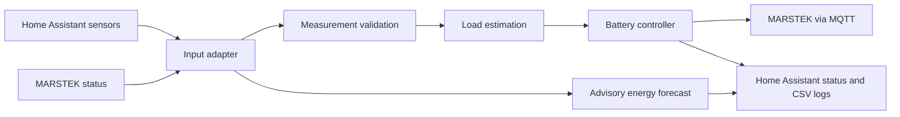

# Residential Energy Management

[](https://github.com/HERMAVA/residential-energy-management/actions/workflows/ci.yml)

Python-based energy manager for a residential setup with Home Assistant and a MARSTEK battery storage system.

It reads household and battery measurements, estimates the current load, and calculates a battery output target. Home Assistant provides sensor data and status reporting; the MARSTEK adapter handles battery communication over MQTT.

The project also provides an advisory forecast of the remaining daily energy balance. Forecasts do not issue battery commands or switch appliances; battery control and recovery are separate active functions.



CI runs Ruff, the full test suite, and a Python compile check on pushes and pull requests. See [Development Workflow](#development-workflow) for local validation commands.

## Features

- Load estimation from Home Assistant power sensors and state-based consumers
- Validation of stale, unavailable and implausible measurements
- Battery output control with deadband and minimum command interval
- Configurable minimum battery output
- SOC-based control inhibition
- Oscillation detection for unstable battery output
- Automatic recovery by temporarily increasing the battery target
- Recovery abort at low SOC and return to the minimum output target
- Home Assistant status entities for monitoring
- CSV logging for diagnostics and analysis
- Persistent recovery state across restarts
- Advisory daily energy balance until sunset with configurable assessment thresholds
- Rolling PV input statistics and interchangeable forecast correction methods
- Persistent daily battery input and output energy counters

## Setup

Requires Python 3.11 or later, Home Assistant, and an accessible MARSTEK MQTT adapter.

```bash
python3 -m venv .venv
.venv/bin/python -m pip install -e '.[dev]'
```

For a new installation, copy [config/sensors.example.yaml](config/sensors.example.yaml) to `config/sensors.yaml` and adapt it to your devices. Keep an existing local configuration when updating. Store credentials in `.env`; local configuration, credentials and runtime data are excluded from Git.

Create `.env` from `.env.example` for a new installation, then enter credentials
and private Bright Sky coordinates in the local `.env` file. Keep an existing
`.env` when updating; it is intentionally ignored by Git.

## Project Structure

```text
scripts/
  run_energy_manager.py      Application entry point

src/energy_manager/
  runtime.py                 Main cycle orchestration
  battery_control.py         Battery control and recovery handling
  recovery.py                Recovery state persistence
  oscillation.py             Oscillation detection
  ha_reporting.py            Home Assistant reporting
  csv_logging.py             Diagnostic CSV logging
  estimation.py              Household load estimation
  validation.py              Measurement validation
  controller.py              Battery target calculation
  daily_energy.py            Daily energy integration and persistence
  models.py                  Shared models and configuration types
  config_loader.py           YAML configuration loading
  settings.py                Runtime and control parameters
  adapters/                  Home Assistant and MARSTEK interfaces
  forecast/
    forecast_input.py          Provider inputs and normalized forecast snapshots
    forecast_data_collection.py Forecast history, CSV logging and collection cycle
    forecast.py                Forecast calculations, statistics and temporary correction

config/
  sensors.example.yaml       Configuration template
  sensors.yaml               Local sensors, outputs and forecast configuration

data/
  *.csv                      Runtime logs
  marstek_recovery_state.json
  battery_daily_energy.json
```

## Configuration

Secrets are stored in `.env`, for example:

```env
HOME_ASSISTANT_URL=...
HOME_ASSISTANT_TOKEN=...

MQTT_HOST=...
MQTT_PORT=1883
MQTT_USERNAME=...
MQTT_PASSWORD=...

MARSTEK_DEVICE_TYPE=...
MARSTEK_DEVICE_MAC=...

# Bright Sky forecast location; keep real coordinates only in local .env
BRIGHTSKY_LATITUDE=...
BRIGHTSKY_LONGITUDE=...
BRIGHTSKY_TIMEZONE=Europe/Berlin
BRIGHTSKY_MAX_DISTANCE_M=50000
```


Sensor configuration is located in:

```text
config/sensors.yaml
```

The example configuration includes:

- `power_sensors`, `estimated_consumers` and `constant_consumers` for household load estimation.
- `battery` for capacity, SOC limits, maximum output and measurement freshness.
- `outputs` for configurable Home Assistant destination entity IDs.
- `forecast_sources` for logical signal names mapped to provider-specific entity IDs and units.
- `forecast_correction` and `energy_forecast` for the advisory model.

Forecast calculations use Wh and W internally. Configure source units explicitly, for example `kWh` for energy and `W` for power.

Bright Sky location settings are read from the local `.env`, not from
`config/sensors.yaml`. Set `BRIGHTSKY_LATITUDE` and `BRIGHTSKY_LONGITUDE` there;
the optional timezone defaults to `Europe/Berlin`, and the station search radius
defaults to 50,000 m. Real coordinates must not be committed or copied into
`.env.example`.

Control and monitoring parameters are located in:

```text
src/energy_manager/settings.py
```

Run commands from the repository root so relative configuration and data paths resolve correctly.

## Energy Forecast

The current assessment covers **the rest of today until sunset**, using `sensor.sun_next_setting` as configured under `forecast_sources.daylight.sunset` and Bright Sky solar irradiation for that remaining interval. The timestamp must include a timezone. The application checks the calendar date in `Europe/Berlin`; tomorrow's sunset is not used to extend today's forecast. Forecast.Solar's remaining-energy value is logged only as a comparison and is no longer used by the calculation.

The daily assessment is recalculated approximately every 60 seconds. Next-hour, tomorrow and weather values are collected for analysis, but do not yet have separate assessments. Weather values do not currently alter the balance calculation.

### Energy balance

```text
effective_pv_wh = estimated_battery_input_from_brightsky_irradiation
consumption_wh = consumption_w × hours_until_sunset / output_efficiency
balance_energy_wh = capacity_wh × SOC / 100
                  + effective_pv_wh × input_efficiency
                  - consumption_wh
reserve_change_wh = effective_pv_wh × input_efficiency - consumption_wh
```

The historical Forecast.Solar correction factor is not applied to Bright Sky estimates. The factor and Forecast.Solar values remain logged for comparison only.

The default **130 W represents total future household consumption**. The current battery output is not added to it. Battery input means PV power arriving at the MARSTEK, including power passed through when the battery is full; it is not net charging power.

`balance_soc_percent` expresses the aggregate balance as a percentage of battery capacity, capped at 0–100%. `reserve_change_wh` describes the expected change from the current stored energy: a negative value means declining reserve.

This is a heuristic balance, not a time-resolved SOC prediction. It does not model charging limits, the timing of PV generation, or individual appliance cycles. A balance surplus is not a measured or guaranteed grid export. Efficiencies default to `1.0`, explicitly assuming no losses until calibrated values are configured.

### Assessment states

The assessment is the **state** of `sensor.residential_energy_forecast_today`, configurable through `outputs.forecast_status_today`. It is also included in the attributes.

| State | Suggested color | Default rule |
| --- | --- | --- |
| `surplus_expected` | Green | Current SOC > 30% and balance SOC > 95% |
| `reserve_at_risk` | Red | Current SOC < 30%, mean recent PV input < 130 W, and `reserve_change_wh` < 0 |
| `limited` | Yellow | Required data is available and neither rule above applies |
| `unavailable` | Gray | Required data is missing, invalid or stale, or today's sunset has passed |

The inequalities are strict: exactly 30% SOC, exactly 130 W input, or zero reserve change does not satisfy the red rule. If low SOC and declining reserve require the input history to distinguish red from yellow, missing or insufficient history results in `unavailable`.

Colors belong to the Home Assistant presentation; the Python model uses the descriptive states above. `data_quality` is separate and currently reports `heuristic` or `unavailable`, not a probability. Yellow does not mean a calculated 50% chance of success.

Useful sensor attributes include `reason`, `sunset_at`, `horizon_hours`, `soc_percent`, `original_pv_wh`, `effective_pv_wh`, `correction_factor`, `correction_status`, `balance_soc_percent`, `reserve_change_wh` and `input_mean_w`.

### Forecast parameters

Configure these under `energy_forecast` in `config/sensors.yaml`:

| Parameter | Default | Meaning |
| --- | --- | --- |
| `consumption_w` | 130 | Assumed total future household load |
| `surplus_min_soc_percent` | 30 | Current SOC must exceed this for green |
| `surplus_target_soc_percent` | 95 | Balance SOC must exceed this for green |
| `reserve_soc_percent` | 30 | Current SOC must be below this for red |
| `input_history_max_age_seconds` | 120 | Maximum age of the latest valid input sample used for assessment |
| `input_efficiency` | 1.0 | Retained fraction of forecast PV energy |
| `output_efficiency` | 1.0 | Efficiency used to convert assumed load into energy demand |
| `max_age_seconds` | 3600 | Maximum age of the remaining-PV forecast reading |

Reserve SOC must not exceed the surplus minimum SOC. Forecast thresholds are independent of battery control SOC limits.

### PV correction

The runtime samples battery input about every 10 seconds. Its rolling history keeps up to 10 minutes and 61 samples, exposing mean, population standard deviation, range, sample count and age. At least 10 valid samples are required where the assessment depends on this history; startup does not require a full 10-minute window.

The initial correction method, `ratio_of_means_v1`, uses a separate history of paired measurements from the same cycles:

```text
raw_factor = mean(measured_pv_input_w) / mean(forecast_power_now_w)
```

`forecast_sources.solar.power_now` maps to `sensor.power_production_now` by default. Invalid or unpaired readings are skipped. A full battery does not disable correction.

Configure the strategy under `forecast_correction`:

| Parameter | Default | Meaning |
| --- | --- | --- |
| `method` | `ratio_of_means_v1` | Temporary strategy selected from `CORRECTION_METHODS` in `forecast/forecast.py` |
| `min_forecast_power_w` | 50 | Minimum mean forecast power for division |
| `min_factor` / `max_factor` | 0.25 / 4 | Bounds applied to the raw ratio |
| `max_age_seconds` | 1800 | Freshness limit for forecast power readings and the latest paired samples |

Both paired histories require at least 10 samples. The factor applies only to today's remaining energy. The raw factor, bounded factor and availability status are logged. These initial limits need calibration; a short-term weather deviation may not persist for the whole remaining day. Additional strategies can be registered without changing source collection or the daily balance interface.

## Daily Battery Energy

The following optional `outputs` publish measured daily totals in kWh:

| Output key | Example entity ID |
| --- | --- |
| `battery_input_energy_today` | `sensor.residential_battery_input_energy_today` |
| `battery_output_energy_today` | `sensor.residential_battery_output_energy_today` |

Input and output power are integrated with the trapezoidal rule. The counters reset at midnight in `Europe/Berlin`, including daylight-saving changes. Totals are saved to `data/battery_daily_energy.json` each cycle and restored after a restart.

Missing, invalid or stale readings and intervals longer than 30 seconds are not integrated. The `complete` attribute marks incomplete days; a first start during the day or a restart leaves the known totals available but marks coverage incomplete. Downtime is not estimated or backfilled. These counters measure energy crossing the input/output interfaces, not the change in stored battery energy.

## Logs

| Daily file in `data/` | Contents |
| --- | --- |
| `energy_forecast_history_YYYY-MM-DD.csv` | Battery, solar forecast and weather snapshots |
| `energy_forecast_daily_v2_YYYY-MM-DD.csv` | Earlier daily balance schema |
| `energy_forecast_daily_v3_YYYY-MM-DD.csv` | Daily balance, correction statistics and Bright Sky battery-input forecasts |
| `brightsky_forecast_YYYY-MM-DD.csv` | Hourly Bright Sky forecast records, archived with retrieval time and valid forecast time |

Forecast CSV timestamps and filename dates use UTC; daily energy resets and sunset date checks use `Europe/Berlin`. Older `energy_forecast_daily_...` files may have the previous schema. Forecast logging normally runs every 60 seconds, subject to cycle duration and communication delays.

Bright Sky forecast collection is separate and runs hourly. It stores available
hourly forecasts from the current time through the end of the day after tomorrow,
including sunshine duration, solar irradiation and cloud cover. Retrieval and
forecast timestamps are both retained so historical forecast snapshots can later
be compared with measured battery input over the matching periods. Bright Sky
values are source weather forecasts, not estimates of energy entering the battery.

The initial estimate uses the historical fit
`battery input kWh = 0.0404 + 0.8515 × solar irradiation kWh/m²`. It was fitted
to five complete October 2026 days (daily Pearson correlation about 0.94), so its
quality is marked `low` until more days are collected. For all forecast days,
red is at or below 85% of battery capacity, yellow is above 85% and at or below
100%, and green is above battery capacity. Tomorrow and day-after-tomorrow do not
use current SOC; today's established SOC balance is retained, with Bright Sky
replacing Forecast.Solar as its PV-input estimate.
Optional Home Assistant status outputs are `forecast_status_tomorrow` and
`forecast_status_day_after_tomorrow`.

Additional outputs expose `battery_input_forecast_now_w` for the Bright Sky
hour containing the current time, `battery_input_forecast_tomorrow_kwh`, and
`battery_input_forecast_tomorrow_error_kwh`. The daily prediction is the latest
available estimate before local midnight. After that local day closes, its
signed error is calculated as actual battery input minus forecast and persisted
in `data/brightsky_forecast_state.json` with the measured-coverage flag.

Correction status, factor and paired input statistics are stored with the daily assessment. For calibration, compare matching time intervals: a stored remaining-energy forecast must be compared with measured input energy **after that forecast timestamp**, not with the whole day's total. Keep original and corrected forecasts to evaluate whether correction improves accuracy.

## Run

Activate the virtual environment and start manually:

```bash
source .venv/bin/activate
python -u scripts/run_energy_manager.py
```

Before a manual test, stop the systemd service to avoid running two instances:

```bash
sudo systemctl stop energy-manager
```

## Raspberry Pi Service

The application normally runs as a systemd service:

```bash
sudo systemctl restart energy-manager
sudo systemctl status energy-manager
journalctl -u energy-manager -f
```

Autostart:

```bash
sudo systemctl enable energy-manager
```

## Development Workflow

Before deploying:

```bash
.venv/bin/python -m pytest -q
.venv/bin/python -m ruff check .
.venv/bin/python -m compileall -q scripts src
```

Synchronize the project from WSL to the Raspberry Pi:

```bash
rsync -av \
  --exclude '.venv' \
  --exclude '.git' \
  --exclude '.env' \
  --exclude 'config/sensors.yaml' \
  --exclude 'data/' \
  ./ pi@raspberrypi.local:~/residential-energy-management/
```

Then restart the service on the Pi.

This synchronization keeps the Pi's local sensor configuration, logs and persistent state intact. Update `config/sensors.yaml` on the Pi separately when adding new source or output mappings. The command intentionally does not use `--delete`.

## Battery Control

Normal control follows the estimated household load while respecting the configured deadband, command interval, SOC limits and minimum output.

If unstable battery output is detected, the recovery strategy temporarily applies a higher output target. Afterwards the controller restores the normal target.

If the SOC reaches the lower limit, low-SOC handling takes priority and the battery target is returned to the configured minimum output after the normal command interval.
