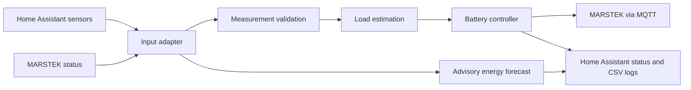

# Residential Energy Management

[](https://github.com/HERMAVA/residential-energy-management/actions/workflows/ci.yml)

Python-based energy manager for a residential setup with Home Assistant and a MARSTEK battery storage system.

It reads household and battery measurements, estimates the current load, and calculates a battery output target. Home Assistant provides sensor data and status reporting; the MARSTEK adapter handles battery communication over MQTT.

The project also provides an advisory forecast of the remaining daily energy balance. Forecasts do not issue battery commands or switch appliances; battery control and recovery are separate active functions.



CI runs Ruff, the full test suite, and a Python compile check on pushes and pull requests. See [Development Workflow](#development-workflow) for local validation commands.

## Features

- Load estimation from Home Assistant power sensors and state-based consumers
- Validation of stale, unavailable and implausible measurements
- Battery output control with deadband and minimum command interval
- Configurable minimum battery output
- SOC-based control inhibition
- Oscillation detection for unstable battery output
- Automatic recovery by temporarily increasing the battery target
- Recovery abort at low SOC and return to the minimum output target
- Home Assistant status entities for monitoring
- CSV logging for diagnostics and analysis
- Persistent recovery state across restarts
- Advisory daily energy balance until sunset with configurable assessment thresholds
- Bright Sky battery-input forecasts for tomorrow and the day after tomorrow
- Configurable PV array azimuth and tilt used as empirical forecast features
- Offline hourly forecast-to-measurement dataset generation and model evaluation
- Persistent daily battery input and output energy counters

## Setup

Requires Python 3.11 or later, Home Assistant, and an accessible MARSTEK MQTT adapter.
MQTT access for the MARSTEK battery must be requested from MARSTEK customer
support through the smartphone app and enabled before the battery can be
integrated. For direct customer support go to settings -> Help & Feedback --> Ask Marstek

### Experimental Home Assistant OS app

This branch also packages the existing manager as a locally built HA app for
`aarch64` (including Green) and `amd64`. The default `run_manager: false` checks
local configuration and exits without network requests or battery commands.
Installation, check mode, the version 0.1.1 JSON-state import and an initial live
cycle have been exercised on Green. HA access, MQTT status reception and target
calculation worked; sustained control and live shutdown still need observation.
Stop the existing service before importing state or enabling control in the app.

See [App installation and operation](DOCS.md) and the German
[container learning guide](docs/container-guide.md). Configuration and state are
mounted outside the image; local secrets and historical measurements are excluded
from the build context. No image publication is configured.

### Tested Hardware

The MARSTEK battery integration has so far been tested only with a **MARSTEK
B2500 running firmware V116.6**. Other battery models and firmware versions have
not yet been tested; compatibility with them is not guaranteed.

```bash
python3 -m venv .venv
.venv/bin/python -m pip install -e '.[dev]'
```

For a new installation, copy [config/sensors.example.yaml](config/sensors.example.yaml) to `config/sensors.yaml` and adapt it to your devices. Keep an existing local configuration when updating. Store credentials in `.env`; local configuration, credentials and runtime data are excluded from Git.

Create `.env` from `.env.example` for a new installation, then enter credentials
and private Bright Sky coordinates in the local `.env` file. Keep an existing
`.env` when updating; it is intentionally ignored by Git.

## Project Structure

```text
scripts/
  run_energy_manager.py      Application entry point

src/energy_manager/
  runtime.py                 Main cycle orchestration
  battery_control.py         Battery control and recovery handling
  recovery.py                Recovery state persistence
  oscillation.py             Oscillation detection
  ha_reporting.py            Home Assistant reporting
  csv_logging.py             Diagnostic CSV logging
  estimation.py              Household load estimation
  validation.py              Measurement validation
  controller.py              Battery target calculation
  daily_energy.py            Daily energy integration and persistence
  models.py                  Shared models and configuration types
  config_loader.py           YAML configuration loading
  settings.py                Runtime and control parameters
  adapters/                  Home Assistant and MARSTEK interfaces
  forecast/
    forecast_input.py          Provider inputs and normalized forecast snapshots
    forecast_data_collection.py Forecast history, CSV logging and collection cycle
    forecast.py                Forecast calculations and input statistics
    power_forecast.py          Pure PV power series and arbitrary energy interval queries
    solar_geometry.py          Sun position and panel orientation features
    offline_analysis.py        Paired hourly data and offline model evaluation

scripts/
  analyze_brightsky_input.py   Build and evaluate offline forecast datasets

config/
  sensors.example.yaml       Configuration template
  sensors.yaml               Local sensors, outputs and forecast configuration

data/
  logs/
    marstek/                 Detailed diagnostics; 10-day retention
    forecast/                Weather, forecast and permanent compact PV history
  analysis/
    forecast/                Generated hourly training pairs
  marstek_recovery_state.json
  battery_daily_energy.json
```

## Configuration

Secrets are stored in `.env`, for example:

```env
HOME_ASSISTANT_URL=...
HOME_ASSISTANT_TOKEN=...

MQTT_HOST=...
MQTT_PORT=1883
MQTT_USERNAME=...
MQTT_PASSWORD=...

MARSTEK_DEVICE_TYPE=...
MARSTEK_DEVICE_MAC=...

# Bright Sky forecast location; keep real coordinates only in local .env
BRIGHTSKY_LATITUDE=...
BRIGHTSKY_LONGITUDE=...
BRIGHTSKY_TIMEZONE=Europe/Berlin
BRIGHTSKY_MAX_DISTANCE_M=50000
```


Sensor configuration is located in:

```text
config/sensors.yaml
```

The example configuration includes:

- `power_sensors`, `estimated_consumers` and `constant_consumers` for household load estimation.
- `battery` for capacity, SOC limits, maximum output and measurement freshness.
- `outputs` for configurable Home Assistant destination entity IDs.
- `forecast_sources` for logical signal names mapped to provider-specific entity IDs and units.
- `solar_array` for the panel azimuth and tilt used by the empirical analysis.
- `energy_forecast` for the advisory daily balance thresholds and consumption assumption.

Forecast calculations use Wh and W internally. Configure source units explicitly, for example `kWh` for energy and `W` for power.

The optional `solar_array` section belongs in `config/sensors.yaml` and the shareable
`config/sensors.example.yaml`, not in `.env`. Azimuth uses 0 degrees north and
increases clockwise; tilt is 0 degrees when horizontal and 90 degrees when
vertical. The example values are azimuth 143 degrees and tilt 60 degrees.
These values are used to calculate empirical features; they are not applied as a
standalone physical multiplier to Bright Sky irradiation.

Bright Sky location settings are read from the local `.env`, not from
`config/sensors.yaml`. Set `BRIGHTSKY_LATITUDE` and `BRIGHTSKY_LONGITUDE` there;
the optional timezone defaults to `Europe/Berlin`, and the station search radius
defaults to 50,000 m. Real coordinates must not be committed or copied into
`.env.example`.

Control and monitoring parameters are located in:

```text
src/energy_manager/settings.py
```

Run commands from the repository root so relative configuration and data paths resolve correctly.

## Energy Forecast

The current assessment covers **the rest of today until sunset**, using `sensor.sun_next_setting` as configured under `forecast_sources.daylight.sunset` and Bright Sky hourly solar irradiation for that remaining interval. The timestamp must include a timezone. The application checks the calendar date in `Europe/Berlin`; tomorrow's sunset is not used to extend today's forecast. Forecast.Solar values are retained as independent comparison data and do not feed the Bright Sky calculation or its runtime correction.

The daily assessment is recalculated approximately every 60 seconds. Bright Sky also provides daily estimated MARSTEK input for tomorrow and the day after tomorrow, with separate status outputs. Weather and solar-position features do not currently alter the active daily balance formula; they are collected for offline model evaluation.

### Energy balance

```text
effective_input_wh = estimated_battery_input_from_brightsky_irradiation
consumption_wh = consumption_w × hours_until_sunset
balance_energy_wh = capacity_wh × SOC / 100
                  + effective_input_wh
                  - consumption_wh
reserve_change_wh = effective_input_wh - consumption_wh
```

The energy estimate uses the existing linear mapping from Bright Sky irradiation
to measured MARSTEK input energy. Its current coefficients are a starting
baseline, not an automatically learned model. The runtime does not update model
parameters online.

The default **130 W represents total future household consumption**. The current battery output is not added to it. Battery input means PV power arriving at the MARSTEK, including power passed through when the battery is full; it is not net charging power.

`balance_soc_percent` expresses the aggregate balance as a percentage of battery capacity, capped at 0–100%. `reserve_change_wh` describes the expected change from the current stored energy: a negative value means declining reserve.

This is a heuristic balance, not a time-resolved SOC prediction. It does not model charging limits, the timing of PV generation, or individual appliance cycles. A balance surplus is not a measured or guaranteed grid export. The configured 130 W is total assumed future household consumption; current battery output is not added to it.

### Assessment states

The assessment is the **state** of `sensor.residential_energy_forecast_today`, configurable through `outputs.forecast_status_today`. It is also included in the attributes.

| State | Suggested color | Default rule |
| --- | --- | --- |
| `surplus_expected` | Green | Current SOC > 30% and balance SOC > 95% |
| `reserve_at_risk` | Red | Current SOC < 30%, mean recent PV input < 130 W, and `reserve_change_wh` < 0 |
| `limited` | Yellow | Required data is available and neither rule above applies |
| `unavailable` | Gray | Required data is missing, invalid or stale, or today's sunset has passed |

The inequalities are strict: exactly 30% SOC, exactly 130 W input, or zero reserve change does not satisfy the red rule. If low SOC and declining reserve require the input history to distinguish red from yellow, missing or insufficient history results in `unavailable`.

Colors belong to the Home Assistant presentation; the Python model uses the descriptive states above. `data_quality` is separate and currently reports `heuristic` or `unavailable`, not a probability. Yellow does not mean a calculated 50% chance of success.

Useful sensor attributes include `reason`, `sunset_at`, `horizon_hours`, `soc_percent`, `original_pv_wh`, `effective_pv_wh`, `correction_factor`, `correction_status`, `balance_soc_percent`, `reserve_change_wh` and `input_mean_w`.

### Forecast parameters

Configure these under `energy_forecast` in `config/sensors.yaml`:

| Parameter | Default | Meaning |
| --- | --- | --- |
| `consumption_w` | 130 | Assumed total future household load |
| `surplus_min_soc_percent` | 30 | Current SOC must exceed this for green |
| `surplus_target_soc_percent` | 95 | Balance SOC must exceed this for green |
| `reserve_soc_percent` | 30 | Current SOC must be below this for red |
| `input_history_max_age_seconds` | 120 | Maximum age of the latest valid input sample used for assessment |

Reserve SOC must not exceed the surplus minimum SOC. Forecast thresholds are independent of battery control SOC limits.

### Bright Sky and panel geometry

Bright Sky solar irradiation is not specific to the plane of the installed PV
modules. The runtime stores hourly irradiation, sunshine duration and cloud
cover. For each forecast interval it can also store solar altitude, solar
azimuth, the cosine of the angle of incidence for the configured panel
orientation, and cyclic day-of-year features. These geometry values are
predictors for empirical analysis; the code does not treat them as a direct
conversion of horizontal irradiation to module-plane energy.

Configure the array orientation in YAML:

```yaml
solar_array:
  azimuth_deg: 143
  tilt_deg: 60
```

The orientation convention is azimuth 0 degrees north, increasing clockwise;
tilt 0 degrees horizontal and 90 degrees vertical. Bright Sky coordinates and
timezone remain in the ignored `.env` file.

The previous `ratio_of_means_v1` helper remains available and tested, but the
runtime no longer calls it. In particular, Forecast.Solar `power_now` is not
used to adjust the Bright Sky estimate. Forecast.Solar snapshots are retained
only as a separate comparison series.

### Offline calibration data

Generate hourly Bright Sky / measured MARSTEK input pairs with:

```bash
.venv/bin/python scripts/analyze_brightsky_input.py \
  --data-dir data \
  --config config/sensors.yaml \
  --max-gap-seconds 60 \
  --decision-time 18:00 \
  --max-snapshot-age-hours 2 \
  --output /tmp/bright_sky_input_training_pairs.csv \
  --model-report /tmp/power_model_comparison.json
```

The tool reads the organized log folders and legacy CSV files directly in
`data/`. It combines detailed V5 measurements with the permanent compact PV
history, counting identical timestamps only once. Conflicting measurements at
the same timestamp are rejected. Analysis exports are not scanned as raw logs.
The default output is `data/analysis/forecast/hourly_training_pairs.csv`.

The tool picks the latest forecast snapshot available before each target hour,
integrates `input_power_w` over that same hour, and excludes intervals with
missing data or gaps over 60 seconds by default. Use `--max-gap-seconds 30` for
the stricter comparison. Values between adjacent readings are integrated with
the trapezoidal rule; allowing longer gaps can smooth short PV fluctuations.
This option only affects offline analysis; daily runtime energy counters keep
their 30-second limit. Older forecast logs without geometry
columns get those features reconstructed from their timestamps, location and
configured array orientation. The output contains forecast lead time, weather,
solar geometry, season and actual battery-input energy.

The offline evaluator holds out later whole local calendar days and compares
the existing hourly power formula, a fitted irradiation-only model, and the
candidate `P = G * (a + b * max(0, cos(incidence)))`. Coefficients are nonnegative;
the candidate has no power offset at zero irradiation. It requires at least
30 training rows and never writes model parameters back to runtime configuration.
An optional `--max-input-power-w` caps predictions when the actual PV input limit
is known; the battery output limit is not substituted. The number of usable
hourly pairs depends on the selected gap limit. More pairs alone do not establish
forecast accuracy, especially for tomorrow or the day after tomorrow.
Collect several weeks of complete measurements before drawing conclusions;
this still does not establish seasonal performance. Any model change requires
offline review and explicit adoption.

The JSON report also contains `horizon_evaluation`. It selects the latest archived
version per target hour within each lead range: [0, 1), [1, 3), [3, 12), [12, 24),
[24, 48), and 48+ hours. Each target is counted once per range. Counts and model
parameters are reported separately; different ranges can contain different targets.

For daily planning, `--decision-time` uses local time in the configured Bright Sky
timezone (default 18:00). Tomorrow and the day after tomorrow each use the last
single weather snapshot available at that decision time, without mixing updates.
`--max-snapshot-age-hours` rejects old snapshots (default 2 hours). Each daily case
records the decision and retrieval times, expected and covered hours, measured
and predicted kWh, and an exclusion reason when incomplete. Local days retain
their actual 23/24/25-hour length. Ambiguous or nonexistent local decision times
at DST transitions are excluded rather than guessed.

The horizon evaluation holds out the same later local target days across all
groups. Within each group the model is fitted once, using only measurements that
end before both the test-day boundary and the earliest evaluated issue time
(the decision time for daily planning). This can leave fewer training pairs for
longer leads. A group without enough training data still reports the fixed hourly
baseline, but leaves fitted-model scores unavailable. Daily scores use only fully
covered matching days and report MAE, RMSE and prediction-minus-measurement bias in
kWh. The daily baseline integrates the existing hourly power formula; it does not
use the separate runtime daily regression. The CSV training export and original
top-level comparison retain their latest-before-target selection.

The separate pure calculation API in `forecast/power_forecast.py` generates one
power series and integrates only the requested interval or local calendar day.
Missing coverage stays unavailable, and DST days retain their actual length.
This API is prepared for future runtime integration; current HA forecasts still
use the existing formulas. See [Forecast model](docs/forecast-model.md) for the
algorithm, interval definitions, units and validation boundaries.

## Daily Battery Energy

The following optional `outputs` publish measured daily totals in kWh:

| Output key | Example entity ID |
| --- | --- |
| `battery_input_energy_today` | `sensor.residential_battery_input_energy_today` |
| `battery_output_energy_today` | `sensor.residential_battery_output_energy_today` |

Input and output power are integrated with the trapezoidal rule. The counters reset at midnight in `Europe/Berlin`, including daylight-saving changes. Totals are saved to `data/battery_daily_energy.json` each cycle and restored after a restart.

Missing, invalid or stale readings and intervals longer than 30 seconds are not integrated. The `complete` attribute marks incomplete days; a first start during the day or a restart leaves the known totals available but marks coverage incomplete. Downtime is not estimated or backfilled. These counters measure energy crossing the input/output interfaces, not the change in stored battery energy.

## Logs

Set `CSV_LOGGING_ENABLED = False` in `src/energy_manager/settings.py` to disable
diagnostic CSV recording; the default is `True`. The setting takes effect on the
next application start and covers MARSTEK status, forecast input history, daily
forecast results and Bright Sky forecast CSV files. Existing files are retained.
Battery control, recovery, in-memory input history, forecast calculation and
Home Assistant publication continue. JSON persistence for recovery, daily energy
and forecast comparisons remains active, as do console/service messages.
Disabled periods leave gaps in the data available for diagnostics and offline
calibration; they are not backfilled.

Runtime CSV files share the writer in `src/energy_manager/csv_logging.py`.
MARSTEK status files retain their existing `LOG_RETENTION_DAYS` cleanup when a
new daily file is created; forecast CSV files are not automatically deleted.

Daily MARSTEK diagnostics are written to `data/logs/marstek/`. Forecast files
are written to `data/logs/forecast/`. Alongside the diagnostics, every received
MARSTEK status records just its timestamp and PV input power in
`pv_input_history_YYYY-MM-DD.csv`. This compact history has no automatic deletion;
it preserves measurements for later hourly integration and shading analysis
after the detailed diagnostics have expired. Bright Sky forecast snapshots are
also retained. Both recordings follow `CSV_LOGGING_ENABLED`.

Existing local CSV files can be organized and V5 input measurements preserved
with the following offline command. Run it with the manager stopped or on an
offline copy; it does not stop or restart the service:

```bash
.venv/bin/python scripts/organize_energy_logs.py --data-dir data
```

The command moves existing diagnostic/forecast CSV files, backfills compact PV
history and can be repeated. It refuses conflicting destination files. JSON
state files and existing analysis reports remain at their original paths.
CSV files already tracked by Git are kept at their original paths as well.
Runtime creates the new log folders automatically; old root-level logs remain
readable by the analysis tool even before organization.

| Daily file in `data/logs/forecast/` | Contents |
| --- | --- |
| `pv_input_history_YYYY-MM-DD.csv` | Permanent timestamp and measured PV input power, without diagnostic payloads |
| `energy_forecast_history_YYYY-MM-DD.csv` | Battery, solar forecast and weather snapshots |
| `energy_forecast_daily_v2_YYYY-MM-DD.csv` | Earlier daily balance schema |
| `energy_forecast_daily_v3_YYYY-MM-DD.csv` | Earlier daily forecast logs; affected versions could overwrite today's result with a later day's estimate |
| `energy_forecast_daily_v4_YYYY-MM-DD.csv` | Daily balance, input-history statistics and separate daily Bright Sky estimates |
| `brightsky_forecast_YYYY-MM-DD.csv` | Hourly Bright Sky weather, irradiation, retrieval time and solar-array feature columns |

Forecast CSV timestamps and filename dates use UTC; daily energy resets and sunset date checks use `Europe/Berlin`. Older `energy_forecast_daily_...` files may have the previous schema. Forecast logging normally runs every 60 seconds, subject to cycle duration and communication delays.

Bright Sky forecast collection is separate and runs hourly. It stores available
hourly forecasts from the current time through the end of the day after tomorrow,
including sunshine duration, solar irradiation, cloud cover, and solar-array
features when `solar_array` is configured. Retrieval and forecast timestamps are
both retained. The target variable is **actual MARSTEK battery input energy**;
the adapter maps `battery_input_w` to the sum of its `w1` and `w2` channels.

The existing Bright Sky daily estimate uses a fixed linear irradiation mapping
and is marked `low` quality. It is a baseline, not a fit that updates itself
from current runtime measurements. The historical error comparison is
diagnostic only. Tomorrow and day-after-tomorrow assessments retain their
existing Python status outputs, configurable as `forecast_status_tomorrow` and
`forecast_status_day_after_tomorrow`; the current daily assessment remains
unchanged.

Additional outputs expose `battery_input_forecast_now_w` for the Bright Sky
hour containing the current time, `battery_input_forecast_tomorrow_kwh`,
`battery_input_forecast_day_after_tomorrow_kwh`, and
`battery_input_forecast_tomorrow_error_kwh`. The two daily kWh outputs represent
estimated battery input from Bright Sky, not Forecast.Solar PV generation.
They publish `unavailable` when the corresponding daily estimate is missing or
incomplete. The day-after-tomorrow output defaults to
`sensor.residential_energy_forecast_day_after_tomorrow_kwh` in the example config.
The daily prediction used for the error comparison is the latest
available estimate before local midnight. After that local day closes, its
signed error is calculated as actual battery input minus forecast and persisted
in `data/brightsky_forecast_state.json` with the measured-coverage flag.

Forecast.Solar data remains in `energy_forecast_history_YYYY-MM-DD.csv` as an
independent comparison series. The runtime does not use Forecast.Solar
`power_now` for a correction factor. The legacy correction helper remains in
the codebase for compatibility and tests, but it is not called from the runtime
cycle.

The offline analysis pairs each Bright Sky hour with integrated MARSTEK input
energy over that hour and retains forecast lead time. It reconstructs solar
geometry for older Bright Sky logs when location and `solar_array` settings are
available. Its chronological holdout compares the existing hourly formula with
fitted irradiance-only and geometry models; model parameters are never
written to runtime configuration. The current local archive is too small for a
meaningful evaluation, so more complete days must be collected first.

## Run

Activate the virtual environment and start manually:

```bash
source .venv/bin/activate
python -u scripts/run_energy_manager.py
```

Before a manual test, stop the systemd service to avoid running two instances:

```bash
sudo systemctl stop energy-manager
```

## Raspberry Pi Service

The application normally runs as a systemd service:

```bash
sudo systemctl restart energy-manager
sudo systemctl status energy-manager
journalctl -u energy-manager -f
```

Autostart:

```bash
sudo systemctl enable energy-manager
```

## Development Workflow

Before deploying:

```bash
.venv/bin/python -m pytest -q
.venv/bin/python -m ruff check .
.venv/bin/python -m compileall -q scripts src
```

Synchronize the project from WSL to the Raspberry Pi:

```bash
rsync -av \
  --exclude '.venv' \
  --exclude '.git' \
  --exclude '.env' \
  --exclude 'config/sensors.yaml' \
  --exclude 'data/' \
  ./ pi@raspberrypi.local:~/residential-energy-management/
```

Then restart the service on the Pi.

This synchronization keeps the Pi's local sensor configuration, logs and persistent state intact. Update `config/sensors.yaml` on the Pi separately when adding new source or output mappings. The command intentionally does not use `--delete`.

## Battery Control

Normal control follows the estimated household load while respecting the configured deadband, command interval, SOC limits and minimum output.

If unstable battery output is detected, the recovery strategy temporarily applies a higher output target. Afterwards the controller restores the normal target.

If the SOC reaches the lower limit, low-SOC handling takes priority and the battery target is returned to the configured minimum output after the normal command interval.
