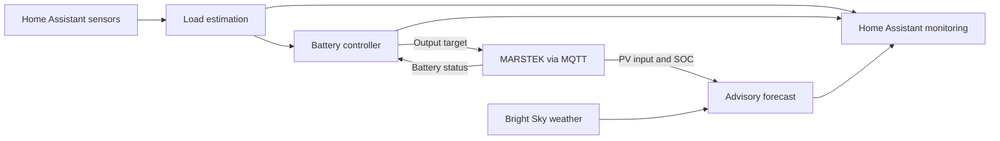

# Residential Energy Management

[](https://github.com/HERMAVA/residential-energy-management/actions/workflows/ci.yml)

Local energy management with Home Assistant and a MARSTEK battery. The Python
application estimates household load, controls battery output, and publishes
measurements and advisory solar forecasts to Home Assistant.

**Forecasts are advisory.** Battery control and recovery operate separately;
forecasts do not issue battery commands or switch appliances.



## Features

- Household load estimation with freshness and plausibility checks
- Battery output control with SOC limits, command intervals and recovery
- Home Assistant monitoring and persistent daily input/output energy counters
- Bright Sky forecasts for the remaining day, tomorrow and the day after tomorrow
- Configurable CSV recording, storage budgets and export through Samba
- Offline forecast calibration and evaluation

## Setup

Requires Home Assistant and MARSTEK MQTT access. Standalone installations also
require Python 3.11 or later. Request MQTT access from MARSTEK support through
**Help & Feedback → Ask Marstek** in the smartphone app.

Tested with a **MARSTEK B2500, firmware V116.6**, including operation on Home
Assistant Green. Other battery models and firmware versions remain untested.

### Home Assistant OS app

The experimental app supports `aarch64` and `amd64`. It starts in local check mode
(`run_manager: false`). Installation, state import, regular operation, logging
and CSV export have been exercised on Green; power-loss recovery remains unverified.

Follow the [app installation guide](DOCS.md) for setup, migration and updates.
Stop the previous manager before enabling battery control in the app.

### Standalone installation

```bash
python3 -m venv .venv
.venv/bin/python -m pip install -e '.[dev]'
```

For a new installation:

1. Copy [.env.example](.env.example) to `.env` and enter your credentials and
   optional Bright Sky coordinates.
2. Copy [config/sensors.example.yaml](config/sensors.example.yaml) to
   `config/sensors.yaml` and adapt the sensors and battery settings.
3. Stop any existing manager instance, then run from the repository root:

   ```bash
   .venv/bin/python -u scripts/run_energy_manager.py
   ```

Keep existing `.env`, `config/sensors.yaml` and `data/` when updating.
See the [user guide](docs/user-guide.md#configuration) for configuration details
and [Raspberry Pi service commands](docs/user-guide.md#raspberry-pi-service).

## Configuration

| Location | Purpose |
| --- | --- |
| HA app options / standalone `.env` | HA and MQTT access, device identifiers and weather location |
| App `sensors.yaml` / standalone `config/sensors.yaml` | Sensor mappings, outputs, battery limits, panel orientation and forecast parameters |
| `src/energy_manager/settings.py` | Runtime and control parameters |

Source units are explicit; calculations use W and Wh internally. Keep credentials,
private coordinates and operational data out of Git.

## Energy Forecast

The application uses Bright Sky weather data to estimate **PV power and energy
entering the MARSTEK**. The current daily assessment covers the time until today's sunset;
separate forecasts cover tomorrow and the day after tomorrow. Forecast.Solar is
recorded as an independent comparison source.

The default **130 W is the assumed total future household consumption**. Forecasts
use a heuristic baseline, report data quality separately, and leave missing data
unavailable. Model parameters are not updated automatically during operation.

Measured daily battery input/output energy is published separately in kWh.
Incomplete measurement coverage is flagged; downtime is not estimated or backfilled.

See the [forecast rules and outputs](docs/user-guide.md#energy-forecast),
[daily energy counters](docs/user-guide.md#daily-battery-energy), and the
[known current-hour update delay](DOCS.md#known-forecast-limitation).

### Offline calibration data

An optional tool pairs archived weather forecasts with measured battery input
and compares the current baseline with fitted models. It does not change runtime
parameters.

```bash
.venv/bin/python scripts/analyze_brightsky_input.py \
  --model-report /tmp/power_model_comparison.json
```

See [calibration usage](docs/user-guide.md#offline-calibration-data) and the
[forecast model documentation](docs/forecast-model.md) for data requirements,
validation and evaluation by forecast lead time.

## Logs

The HA app records compact PV measurements and weather forecasts by default.
Detailed diagnostics are optional:

| App option | Default |
| --- | --- |
| `forecast_data_logging` | `true` |
| `debug_logging` | `false` |
| `forecast_log_max_mib` | `200` shared by PV and weather CSV |
| `debug_log_max_mib` | `10` per diagnostic directory |

Budgets are in MiB. Older completed UTC-day CSV files can be removed when space
is needed; today's files remain protected. Recording pauses if protected files
fill the budget. Export data you want to keep before it expires.

Use the app's [Samba export](DOCS.md#export-measurement-csv-files-through-samba-version-030)
to copy measurements to your computer. See [recording and storage settings](DOCS.md#development-data-and-disk-limits-version-020)
and the [log reference](docs/user-guide.md#logs) for file formats and standalone settings.

## Project Structure

| Path | Contents |
| --- | --- |
| `src/energy_manager/` | Runtime, load estimation, control and adapters |
| `src/energy_manager/forecast/` | Forecast calculations, weather inputs and offline analysis |
| `scripts/` | Manager entry point and analysis tools |
| `config/` | Shareable configuration template and local sensor configuration |
| `tests/` | Unit and integration tests |

## Development Workflow

Run the checks before deploying:

```bash
.venv/bin/python -m pytest -q
.venv/bin/python -m ruff check .
.venv/bin/python -m compileall -q scripts src
```

CI runs these checks and is configured to build and validate the app image.
See the [deployment workflow](docs/user-guide.md#development-workflow) for
synchronization with a standalone Raspberry Pi installation.

## Documentation

- [Home Assistant app](DOCS.md): installation, state import, export and updates
- [User guide](docs/user-guide.md): configuration, forecast rules, logs and services
- [Forecast model](docs/forecast-model.md): calculation and validation details
- [Container guide](docs/container-guide.md): how the app packaging works
- [Changelog](CHANGELOG.md): app versions and behavior changes

## License

This project is licensed under the [MIT License](LICENSE).
