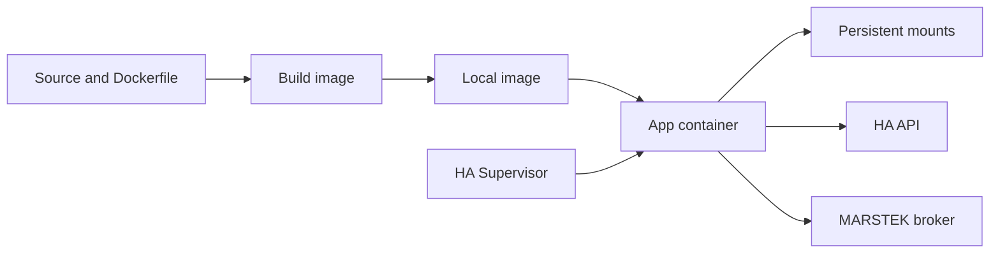

# Understanding containers and the Home Assistant app

The app packages the existing Python manager for Home Assistant OS. It has been
built and operated on Green; power-loss recovery and other battery hardware
remain unverified. For installation and everyday use, follow the [app guide](../DOCS.md).

## Container basics

A Python virtual environment isolates packages. A container also isolates the
filesystem view, processes and networking, while sharing the host kernel.
On Green, Docker and the HA Supervisor manage containers on HA OS.

| Term | Role |
| --- | --- |
| Dockerfile | Instructions for building the application image |
| Image | Python, dependencies and installed code |
| Container | A running or stopped instance of an image |
| Mount | External storage made available inside the container |
| Supervisor | Builds or installs, starts and stops the HA app |
| Registry | An optional service for publishing built images |



Building creates an image; starting a container runs its entry point; pushing
publishes an image to a registry. This project builds locally and does not
publish images automatically.

## How this image works

The [Dockerfile](../Dockerfile) uses `python:3.11-slim-bookworm` and installs the
project with `pip install .` at build time. Only application files and the sensor
template are copied. `.dockerignore` excludes local configuration and measurements.

The working directory is `/app`. Python writes console output immediately and
avoids `.pyc` files. The entry point, `energy_manager.home_assistant_app`, reads
HA options before starting the existing manager through `os.execv()`.

Green builds for `aarch64`; CI is configured for `amd64`. Source changes require
rebuilding the image. Docker can cache unchanged layers, but dependency installation
runs again when the preceding source-copy layer changes. Base-image tags and
unpinned dependencies can change between builds.

## Persistent data and configuration

| Container path | Contents |
| --- | --- |
| `/app` | Application code from the image |
| `/config` | App-specific `sensors.yaml`, state-import files and CSV exports |
| `/data` | Private options, operational JSON state and measurement logs |

Links from `/app/config` and `/app/data` preserve the manager's relative paths.
Mounts survive container replacement; uninstalling the app can remove data, so
backups are still needed. The app's `/config` is separate from HA Core's config.
Its `/data` is not directly accessible through Samba.

Repository-root `config.yaml` describes the app and its options. The installation's
`sensors.yaml` defines sensors, battery parameters and forecast sources. The
Supervisor writes option values to `/data/options.json`; the launcher maps them
to the existing environment variables.

## Connections and process lifecycle

The app connects outward to HA, MQTT and Bright Sky and exposes no inbound ports.
HA supplies a Supervisor token for `http://supervisor/core`; a personal HA token
is unnecessary. This access has administrator privileges. Credentials must stay
out of images and logs, and password fields do not guarantee encrypted storage.
For Mosquitto on the same HA instance, use `core-mosquitto`; `localhost` refers
to the container itself.

The default `run_manager: false` checks local files and options, then exits.
A stopped app is expected after this check; it does not verify connectivity or
sensor existence. Missing sensor configuration is created from the template once
and must be adapted before operation.

`run_manager: true` enables battery control. Run only one manager against a battery.
The Docker init process (`init: true`) forwards signals and reaps child processes.
Normal shutdown sends SIGTERM to the manager's existing handler; HA allows up to
60 seconds before forcing a stop. Power loss and SIGKILL prevent cleanup.

## Builds, updates and operating procedures

To build locally without starting the manager:

```bash
docker build --tag residential-energy-manager:dev .
```

The final dot is the build context. `.gitignore` controls Git;
[`.dockerignore`](../.dockerignore) controls files available to the build.

For a local HA app, update the source in its existing app directory, increase
`version` in `config.yaml`, check for updates and install the new version.
**A restart alone does not install changed source code.**

Detailed procedures are in the app guide:

- [Installation and migration](../DOCS.md#local-installation)
- [Import existing state](../DOCS.md#import-existing-state-version-011)
- [Export measurement CSV files through Samba](../DOCS.md#export-measurement-csv-files-through-samba-version-030)
- [Recording options and storage budgets](../DOCS.md#development-data-and-disk-limits-version-020)
- [Development checks and validation limits](../DOCS.md#development-and-validation)

For background, see the [Dockerfile reference](https://docs.docker.com/reference/dockerfile/)
and [HA app configuration](https://contributors.home-assistant.io/apps/reference/configuration/).
