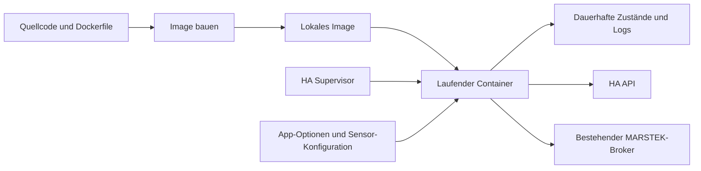

# Container und Home-Assistant-App verstehen

Diese Anleitung erklärt die erste App-Version dieses Projekts. Sie richtet sich
an jemanden, der Python kennt und Container anhand des eigenen Projekts lernen
möchte. Der Code liegt auf `feat/home-assistant-app`. Installation, Zustandsimport
und ein erster Betriebszyklus auf der Green wurden am 26.10.2026 vom Nutzer
bestätigt. Dauerbetrieb und tatsächliche Stellwertübernahme sind noch zu beobachten.

## 1. Welche Aufgabe löst der Container?

Bisher stellen wir auf dem Pi Python, eine virtuelle Umgebung, Abhängigkeiten,
Quellcode und den systemd-Dienst bereit. Das Image beschreibt stattdessen eine
gemeinsame Laufzeitumgebung mit Python und unserem installierten Programm.
HA übernimmt das Starten des daraus erzeugten Containers.

Eine virtuelle Python-Umgebung trennt hauptsächlich Python-Pakete. Ein Container
trennt zusätzlich Dateisystemansicht, Prozesse und Netzwerk. Er verwendet den
Kernel des Hosts; er enthält normalerweise keinen eigenen vollständigen Kernel
wie eine virtuelle Maschine. Auf einer Home Assistant Green ist HA OS dieser Host.
Docker und der HA Supervisor kümmern sich dort um die Containerverwaltung.

Das vereinfacht Installation und Updates. Es beseitigt keine fachlichen Fehler
im Python-Code und garantiert keine ununterbrochene Batterieregelung.

## 2. Image, Container, Registry und Supervisor

| Begriff | Bedeutung in unserem Projekt |
| --- | --- |
| Dockerfile | Bauanleitung für die Laufzeitumgebung |
| Image | Ergebnis des Builds: Dateisystemschichten mit Python, Bibliotheken und Code |
| Container | Laufende oder gestoppte Instanz eines Images mit eigener beschreibbarer Schicht |
| Registry | Optionaler Server zum Verteilen fertiger Images |
| Supervisor | HA-Komponente, die unsere App baut beziehungsweise installiert, startet und stoppt |
| Mount | Ein Verzeichnis, das dem Container von außen bereitgestellt wird |



Ein Image zu bauen startet noch kein Programm. Ein Containerstart führt dagegen
den festgelegten Einstiegspunkt aus. Ein Push lädt ein Image in eine Registry.
Diese drei Handlungen sind getrennt. Unsere erste Version baut lokal; es gibt
keinen automatischen Registry-Push. Code, den wir in ein öffentliches Git-Repo
pushen, ist weiterhin öffentlich; deine Laufzeitdaten gehören nicht hinein.

## 3. Unser Dockerfile Schritt für Schritt

```dockerfile
FROM python:3.11-slim-bookworm
```

Wir beginnen mit dem offiziellen Python-Image für Python 3.11 auf einem schlanken
Debian-Benutzersystem. Python 3.11 wird bereits in unserer CI getestet. Das
Basisimage enthält unter anderem HTTPS-Zertifikate und Zeitzonendaten. Deshalb
brauchen wir für die erste Version keine zusätzliche Linux-Paketinstallation.
Ein spezielles HA-Basisimage ist nicht vorgeschrieben; seine zusätzlichen
Werkzeuge benötigen wir für diesen einzelnen Python-Prozess nicht.

Die Green verwendet ARM64, in HA `aarch64` genannt. Viele Entwicklungsrechner
verwenden `amd64`. Das Python-Basisimage wird für beide Architekturen angeboten.
Beim nativen Build auf der Green wird die ARM-Version verwendet. Ein lokal auf
einem x86-Rechner gebautes Image lässt sich nicht ohne Weiteres auf ARM starten.
Unsere CI ist für amd64 konfiguriert; der Nutzer hat zusätzlich auf der Green
ein ARM64-Image gebaut und installiert.

```dockerfile
ENV PYTHONUNBUFFERED=1 \
    PYTHONDONTWRITEBYTECODE=1 \
    PIP_DISABLE_PIP_VERSION_CHECK=1
WORKDIR /app
```

`ENV` setzt Standard-Umgebungsvariablen im Image. Python schreibt dadurch
Konsolenmeldungen sofort in die HA-Logs und erzeugt keine unnötigen `.pyc`-Dateien.
Diese Variablen enthalten keine Zugangsdaten. `WORKDIR` legt das Arbeitsverzeichnis
fest: Relative Python-Pfade werden später von `/app` aus aufgelöst.

`COPY` übernimmt anschließend gezielt `pyproject.toml`, README, `src/`, den bisherigen
Einstiegspunkt und die teilbare Sensorvorlage. Unsere lokale `.env` und Messreihen
werden nicht kopiert.

```dockerfile
RUN python -m pip install --no-cache-dir . \
    && ln -s /data /app/data \
    && ln -s /config /app/config
```

`RUN` wird während des Builds ausgeführt. `pip install .` installiert das Projekt
und seine in `pyproject.toml` beschriebenen Abhängigkeiten. Diese Installation
passiert beim Bauen des Images, nicht bei jedem Containerstart.

Docker kann bereits gebaute Schichten wiederverwenden. Änderungen an kopierten
Dateien können nachfolgende Schritte erneut auslösen. In dieser einfachen Version
führt eine Quellcodeänderung deshalb auch wieder zur Paketinstallation. Das ist
für den Einstieg überschaubar; spätere Optimierungen können Abhängigkeiten und
Projektinstallation in getrennte Cache-Schichten aufteilen.

Die beiden `ln -s` erzeugen symbolische Links. Sie verweisen aus `/app` auf die
von HA gemounteten Verzeichnisse. Warum das wichtig ist, erklärt der nächste Abschnitt.

```dockerfile
STOPSIGNAL SIGTERM
ENTRYPOINT ["python", "-m", "energy_manager.home_assistant_app"]
```

`ENTRYPOINT` wird beim Containerstart ausgeführt. Die JSON-Schreibweise startet
Python direkt. Der neue App-Starter liest die HA-Optionen und führt im Betriebsmodus
anschließend den bisherigen Einstiegspunkt aus. `STOPSIGNAL` legt das normale
Stoppsignal fest. Beides ist für eine kontrollierte Beendigung wichtig.

## 4. Warum Daten außerhalb des Images liegen

Ein Image enthält die Programmversion. Ein Container kann zusätzlich Dateien
schreiben; diese Änderungen sind aber an diesen Container gebunden. Ein bloßer
Neustart erhält seine beschreibbare Schicht. Wird der Container beim Update
ersetzt, müssen wichtige Daten in einem dauerhaften Mount liegen.

| Sicht des bisherigen Python-Codes | Auflösung im Container | Dauerhafter Inhalt |
| --- | --- | --- |
| `config/sensors.yaml` | `/app/config/sensors.yaml` → `/config/sensors.yaml` | Deine Anlagenkonfiguration |
| `data/battery_daily_energy.json` | `/app/data/battery_daily_energy.json` → `/data/battery_daily_energy.json` | Energiezähler |
| `data/marstek_recovery_state.json` | `/app/data/marstek_recovery_state.json` → `/data/marstek_recovery_state.json` | Recovery-Zustand |
| `data/logs/forecast/` | `/app/data/logs/forecast/` → `/data/logs/forecast/` | Wetter- und PV-Archive |

So können unsere bisherigen relativen Pfade erhalten bleiben. Wir brauchen dafür
keine Änderungen an der Recovery-Logik oder an den Energiezählern.

HA stellt `/data` als privaten App-Speicher bereit. Unsere App-Beschreibung fordert
zusätzlich ihr öffentlich zugängliches Konfigurationsverzeichnis als `/config` an.
„Öffentlich“ bedeutet hier für dich über HA-Dateiwerkzeuge zugänglich, nicht im
Internet veröffentlicht. Dieses Verzeichnis ist nicht die Konfiguration von HA Core.

Mounts erhalten Daten über App-Updates hinweg. Sie ersetzen kein Backup und schützen
nicht automatisch beim Deinstallieren. Optionen und Backups können Zugangsdaten
enthalten. Für die spätere Migration müssen bestehende Zustände gezielt übernommen
werden; allein der neue Container übernimmt keine Pi-Dateien.

## 5. Zwei verschiedene Konfigurationsdateien

Die neue **`config.yaml` im Repository-Hauptverzeichnis** beschreibt die HA-App:
Name, Version, Architektur, Berechtigungen, Mounts und Formularfelder.

Die vorhandene **`config/sensors.yaml`** bleibt die fachliche Anlagenkonfiguration:
Sensor-IDs, Batterieparameter und Forecast-Quellen. Sie gehört deiner Installation.
Das Image enthält ausschließlich die teilbare Beispielversion.

Der Supervisor speichert die Formularwerte als `/data/options.json`. Unser
App-Starter übersetzt diese Werte in die bereits vom Projekt verwendeten
Umgebungsvariablen wie `MQTT_HOST` oder `MARSTEK_DEVICE_MAC`. Es gibt weiterhin
denselben Python-Kern und dieselben Adapter.

Für den HA-Zugriff setzt der Starter die Basisadresse `http://supervisor/core`.
Unser vorhandener Adapter ergänzt `/api/...`. Der Supervisor stellt dafür den
Token bereit; ein persönlicher HA-Token muss nicht kopiert werden. Dieser Zugriff
hat Administratorrechte und der Token gehört weder ins Image noch ins Log.
Das als Passwort markierte MQTT-Feld wird in der Oberfläche verborgen; das ist
keine Garantie verschlüsselter Speicherung von Optionen und Backups.

BrightSky-Koordinaten sind optional. Beide fehlen bedeutet keine Wetterprognose;
eine einzelne Koordinate wird als Konfigurationsfehler abgelehnt. Null ist eine
gültige Koordinate. Die App prüft Zahlenbereiche und Zeitzonen vor einem Start.

## 6. Netzwerk: Warum wir keine Ports freigeben

Das Programm verbindet sich als Client mit HA, dem bisherigen MQTT-Broker und
BrightSky. Es bietet selbst keinen Webserver an. Dafür ist keine Portfreigabe
auf der Green erforderlich. Eine Weboberfläche und Ingress sind somit noch kein
Teil dieser Version.

Jeder Container hat seine eigene Netzwerkansicht. `localhost` bezeichnet dort
den eigenen Container. Für den Broker bleibt die bisher verwendete erreichbare
Adresse maßgeblich. Nur wenn du tatsächlich die Mosquitto-App als Broker benutzt,
ist etwa `core-mosquitto` der passende interne Name. Eine App-Verpackung wechselt
nicht automatisch den Broker oder die Art der MARSTEK-Kommunikation.

## 7. Kontrolliertes Starten und Stoppen

Die Voreinstellung ist `run_manager: false`. Der Starter prüft dann nur lokale
Dateien und Optionen und beendet sich. Das ist kein Verbindungscheck und prüft
nicht, ob deine Sensor-IDs in HA existieren. Der Container bleibt danach nicht
laufend; der Zustand „gestoppt“ ist bei erfolgreichem Prüfmodus erwartbar.

Fehlt die Sensor-Konfiguration, wird einmalig die Vorlage angelegt. Der Starter
beendet sich mit einem Hinweis, damit du sie zunächst anpassen kannst.
Vorhandene Konfigurationen werden nicht überschrieben.

Erst `run_manager: true` aktiviert den bisherigen Energie-Manager samt
Batterieregelung. Der Starter verwendet `os.execv()`: Sein Prozess wird durch
den Manager ersetzt. Es bleibt kein zusätzlicher Python-Starter davor hängen.
Die Einstellung `init: true` lässt Docker einen kleinen Init-Prozess vorschalten,
der Signale weitergibt und beendete Kindprozesse aufräumt. Unser Python-Basisimage
hat kein eigenes S6-Init, daher ist diese Einstellung hier passend.

Beim normalen Stopp bekommt der Manager SIGTERM. Sein bereits bestehender
Signalhandler behandelt das wie eine kontrollierte Unterbrechung und kann bei
aktiver Recovery den bisherigen Abbruchpfad aufrufen. HA wartet in dieser Version
bis zu 60 Sekunden. Danach kann ein erzwungener Stopp folgen. Stromausfall und
SIGKILL erlauben keinen Python-Aufräumcode. Ein Prozess-Test mit gemockten Adaptern
prüft den bisherigen Handler; echte Container-Signalzustellung ist noch auf der
Green zu prüfen.

Der vorherige Pi-Dienst und eine aktive App dürfen nicht gleichzeitig dieselbe
Batterie regeln. Die Installation im Prüfmodus und die spätere Betriebsübergabe
sind deshalb getrennte Schritte.

## 8. Build-Kontext, Git und private Dateien

```bash
docker build --tag residential-energy-manager:dev .
```

Der abschließende Punkt ist der Build-Kontext: das Verzeichnis, aus dem Docker
Dateien übernehmen darf. `.gitignore` steuert ausschließlich Git. Für Docker
gibt es die eigenständige `.dockerignore`.

Unsere `.dockerignore` beginnt mit einem Ausschluss aller Dateien und erlaubt
anschließend nur die benötigten Quellen. Zusätzliche Regeln schließen Python-Caches
und Umgebungsdateien aus. Die gezielten `COPY`-Anweisungen sind eine weitere
Begrenzung dessen, was tatsächlich ins Image kommt. Der Build benötigt weder
MQTT-Passwörter noch einen HA-Token. Solche Werte werden erst beim Start übergeben.

Der lokale Name `residential-energy-manager:dev` bezeichnet dein Image. Er ist
keine automatische Veröffentlichung. Ein Registry-Push wäre eine eigene Handlung;
auch unsere neue CI baut nur und veröffentlicht kein Image.

## 9. Wie Änderungen beim laufenden Programm ankommen

Eine Änderung im Git-Branch ändert nur die Quelldateien. Ein bereits laufender
Container benutzt weiter sein bisheriges Image. Für neuen Code ist ein neuer
Build und ein Containerwechsel nötig. Ein bloßer Neustart baut nichts neu.

Für eine lokale HA-App aktualisierst du die Quelldateien im lokalen App-Verzeichnis,
erhöhst `version` in der App-`config.yaml`, lässt HA nach Updates suchen und
installierst die neue Version. Die Daten-Mounts werden wieder eingebunden.

Der Basisimage-Tag fixiert Python-Haupt-/Nebenversion und Debian-Variante, aber
nicht jedes Byte des Images. Der Tag kann aktualisiert werden; auch unsere
Python-Abhängigkeiten sind noch nicht vollständig festgeschrieben. Für exakt
wiederholbare Releases wären ein geprüfter Image-Digest und feste Paketversionen
der nächste Schritt. Sicherheitsupdates müssen dann bewusst eingepflegt werden.

## 10. Was bereits geprüft wird und was noch fehlt

- Python-Tests prüfen Optionsübersetzung, Fehlerbehandlung, Schutz vorhandener
  Konfiguration, Prüfmodus ohne Netzwerkzugriffe und den bisherigen SIGTERM-Pfad.
- CI soll das Image auf amd64 bauen und den Prüfmodus mit temporären Mounts,
  Dummy-Zugangsdaten und `--network none` ausführen.
- In der Entwicklungsumgebung ist Docker noch nicht installiert. Der Nutzer hat
  das Image auf der Green gebaut, installiert und die drei JSON-Zustände importiert.
- Ein erster Betriebszyklus mit HA-Zugriff, MQTT-Status und Zielwertberechnung
  wurde bestätigt. Dauerbetrieb, tatsächliche Stellwertübernahme und Stoppen
  über den Supervisor sind noch separat zu prüfen.

Die manuelle Installation und der spätere Übergang stehen in [DOCS.md](../DOCS.md).
Nach Installation und Prüfmodus von Version 0.1.0 wurden mit Version 0.1.1
der Zustandsimport und ein erster Betriebszyklus vom Nutzer erfolgreich ausgeführt.

## Ergänzung: Offline-Zustandsimport in Version 0.1.1

Die private `/data`-Ablage lässt sich über die normale Samba-Freigabe nicht direkt
befüllen. Deshalb kann der App-Starter nun ausdrücklich angeforderte Zustände
aus `/config/state-import/` übernehmen. Die Option `import_state` funktioniert
ausschließlich bei ausgeschaltetem `run_manager`. Sie prüft die drei bekannten
JSON-Formate, übernimmt die Bytes unverändert und beendet die App wieder.

Vorhandene abweichende Zustände werden nicht überschrieben. Identische Dateien
können erneut geprüft werden. Auch beim Kopieren gibt es keinen Netzwerk- oder
Gerätezugriff. Ein noch offener Recovery-Vorgang wird gemeldet und nicht durch
Änderung seiner Zeitstempel oder Sollwerte aufgelöst. Die eigentliche Recovery-
und Batterie-Logik bleibt unverändert. Nach der Übernahme wird die Importoption
wieder deaktiviert. Die Schrittfolge für SCP und Samba steht in DOCS.md.

Die Ergänzung wurde vom Nutzer auf der Green installiert. Der Import aller drei
Zustandsdateien war erfolgreich; ein offener Recovery-Vorgang wurde nicht gemeldet.
Beim anschließenden Start scheiterte zunächst der Zugriff auf die LAN-IPv6-Adresse
des Brokers. Mit dem internen Namen `core-mosquitto` funktionierte die Abfrage des
auf derselben Green laufenden Brokers. Ein erster Zyklus lieferte reale Batterie-
Messwerte und einen berechneten Sollwert. Dies belegt noch keine bestätigte
Stellwertübernahme und keinen Langzeittest. Deployment und Aktivierung wurden
vom Nutzer vorgenommen.

## Weiterführende Primärquellen

- [Docker: Container ausführen](https://docs.docker.com/engine/containers/run/)
- [Docker: Build-Kontext und dockerignore](https://docs.docker.com/build/concepts/context/)
- [Dockerfile-Anweisungen](https://docs.docker.com/reference/dockerfile/)
- [HA: lokale App erstellen](https://contributors.home-assistant.io/apps/first-app/)
- [HA: App-Konfiguration](https://contributors.home-assistant.io/apps/reference/configuration/)
- [HA: Optionen](https://contributors.home-assistant.io/apps/guides/options/)
- [HA: API-Kommunikation](https://contributors.home-assistant.io/apps/guides/communication/)
